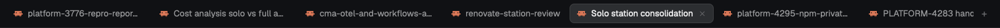

# Session titles: tabs

A [Herdr](https://herdr.dev) mod: the tab bar, with each agent's tab labeled by its live session title. Rename a Claude Code session with `/rename` and the tab follows. The shipped tab bar keeps the name the tab got when it was made, often just "Claude Code".

## Install

1. Copy `mods/session-titles-tabs/` into `~/.config/herdr-app/mods/`.
2. Point your layout's tab bar at it. In `~/.config/herdr-app/layouts/<your layout>.json`, the block with `"id": "tabs"` gets `"content": { "mod": "session-titles-tabs" }`. Clone a shipped layout first (`herdr-app do layout.clone '{"name":"main","as":"my-layout"}'`), since shipped layouts are replaced on every start.
3. `herdr-app check ~/.config/herdr-app/mods/session-titles-tabs`

A name you give a tab by hand shows only while no agent in it has a session. While one does, the session title wins.

See [RECIPE.md](RECIPE.md) for how it's built. Upstream issue: [herdrdev/herdr-app#618](https://github.com/herdrdev/herdr-app/issues/618).

## License

Apache-2.0. Modified from the `tabs` mod shipped with Herdr 0.1.13 ([herdrdev/herdr-app](https://github.com/herdrdev/herdr-app), Apache-2.0). `session.js`, the session-title parser, comes from [choam2426/herdr-session-titles](https://github.com/choam2426/herdr-session-titles) (Apache-2.0), which does the same for the Agents list and pane headers. See [NOTICE](NOTICE).

## Development

`npm install`, then `npm run lint` (Biome, lint only: the mod follows upstream's formatting so it stays easy to diff against the shipped `tabs` mod) and `npm test` (the session-title parser in `session.js`). The tab bar itself needs a running Herdr: check it with `herdr-app check`.
