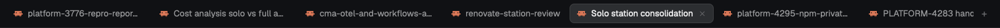

# Session titles: tabs

Herdr's tab bar, except that a tab holding a coding agent is labeled with the agent's live session title. When you `/rename` a Claude Code session, or Claude Code names the conversation after your first prompt, the tab changes within a second. The stock bar keeps the name the tab was given when it was made, often just "Claude Code".

## What you see

The same bar as the shipped `tabs` mod, a 42px block across the top of the window:

- **Tabs, left to right**, as pills 29px high: 10px side padding, 7px gaps, 7px corners, 12.8px text, labels truncated at 170px. The active tab has a `theme.border` outline on `theme.raised`; the others sit on `theme.chrome` in `theme.muted`. Each pill shows the program's icon, then its label.
- **The label:**
  1. the session of the first agent in the tab that has one: Claude Code's conversation title, Codex's thread, Pi's session, OpenCode's session;
  2. otherwise the tab's stored name;
  3. otherwise, for a tab Herdr never named, the program's name ("Terminal" when there is none).

  A zoomed tab gets " Z" after the label.
- **To the right of the tabs:** a 26px "+" button, the Files and Changes panel buttons (whichever shared `workspace.panels` enables), and on Windows or a frameless window, minimize, maximize and close.

## How it behaves

- **Status:** a working agent shows a 12px spinner after the label (`theme.working`, one turn per 900ms). Blocked or done shows a 6px dot in `theme.blocked` or `theme.done`. Idle shows nothing.
- **The label is live:** it's read from the agent's terminal title on every render, with no polling. It never writes the tab's stored name.
- **Clicks:** click selects a tab; drag one pill onto another to move it; double-click opens Herdr's rename prompt; right-click opens the tab menu; the active tab's × closes it; scrolling over the bar steps through tabs. "+" opens the new-tab menu.
- **A name you give the tab** (double-click or `tab.rename`) shows only while no agent in the tab has a session. While one does, the session wins. Rename the session to rename the tab.
- **The side panel** (Files, Changes) is remembered per space, as in the shipped bar.

## Built from

- A clone of the shipped `tabs` mod (Herdr 0.1.13): `herdr-app do mod.clone '{"name":"tabs","as":"session-titles-tabs"}'`. `mod.json` is unchanged apart from `cloned_from`.
- `session.js` beside `main.js`, taken from [choam2426/herdr-session-titles](https://github.com/choam2426/herdr-session-titles), whose `session-titles-agents` and `session-titles-pane` mods carry the same file. Its `session(t)` takes a pane (`title`, `app`, `program`) and returns the session the title names, or `""`. It tells the harness apart by `app`, then `program.key`, then the title's shape, strips spinners and status marks, and returns `""` for paths, passing states ("working", "idle") and the program's own name.
- The change to `main.js`, in the per-tab `item`: collect the tab's panes, take `session()` of each pane that is an agent (`program.agent` or `app`), and use the first non-empty one as the label before falling back to the shipped logic.
- `herdr` functions: `spaces`, `panes`, `run`, `openOverlay`, `theme`, `window`, `shared`, `layout`, `settings`. Commands: `tab.select`, `tab.move`, `tab.rename`, `tab.close`, `tab.prev`, `tab.next`, `layout.select`, `layout.show`, `layout.hide`, `window.minimize`, `window.maximize`, `window.close`. Overlays: `menu`, `new-menu`.
- To use it, point the layout's tab-bar block at it: the block with `"id": "tabs"` gets `"content": { "mod": "session-titles-tabs" }`. Clone the layout first if it's a shipped one.

## Watch out

- Art comes from shipped mods by path: `mods/pane/close.svg`, `mods/workspace-chrome/spinner.svg`, and on Windows `mods/tabs/win-*.svg`. The clone copies the `win-*` files, but `main.js` still reads them from `mods/tabs/`.
- Herdr's stored tab name is set once: from the terminal's hc `name` or the program's name when a running terminal is given a tab (`keep_terminal`), or empty when a labeled terminal is adopted. Don't try to fix stale names by writing `tab.rename` from the mod. Showing the session is enough, and it leaves the stored name alone.
- Claude Code titles its terminal "Claude Code" until the conversation has a title, and `session()` returns `""` for that, so a new tab shows its stored name until then.
- Gemini CLI's title carries no session, so Gemini tabs keep their stored names.
- Keep `session.js` identical across the `session-titles-*` mods. Each folder carries its own copy so it stands alone.
- A clone isn't updated with Herdr. When the shipped `tabs` mod changes, re-clone it and re-apply the `item` change.

## Done when

- `herdr-app check` passes for the mod folder, and `herdr-app status` shows no errors after the layout points at it.
- In a Claude Code tab whose stored name is "Claude Code", `/rename my-task` changes the tab's label to "my-task" within a second, while `herdr-app ls` still shows the stored name.
- A tab running only a shell shows its stored name, or the program's name if it was never named.
- Double-clicking a tab opens the rename prompt. Drag-to-move, the close button, scrolling, "+" and the panel buttons work as in the shipped bar.
